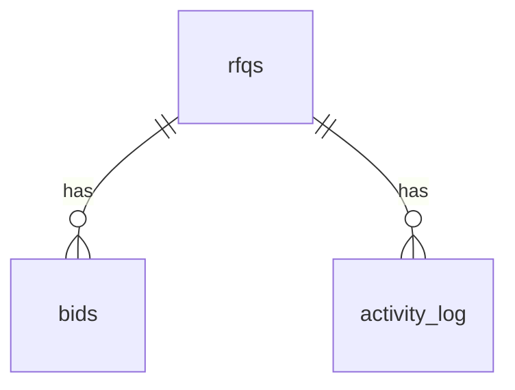

# Schema

### rfqs
| column | type | notes |
|---|---|---|
| id | INTEGER PK | |
| ref_id | TEXT UNIQUE | RFQ reference id |
| name | TEXT | |
| bid_start | TEXT (UTC ISO) | |
| original_close | TEXT | close time set at creation, never changes |
| bid_close | TEXT | current close time, moves on extension |
| forced_close | TEXT | hard limit, must be > bid_close |
| pickup_date | TEXT | |
| trigger_window | INTEGER | X minutes |
| extension_minutes | INTEGER | Y minutes |
| trigger_type | TEXT | BID / ANY_RANK / L1_RANK |
| created_at | TEXT | |

### bids
| column | type | notes |
|---|---|---|
| id | INTEGER PK | |
| rfq_id | FK -> rfqs | |
| carrier_name | TEXT | |
| freight_charges | REAL | |
| origin_charges | REAL | |
| destination_charges | REAL | |
| total | REAL | sum of the three, used for ranking |
| transit_days | INTEGER | |
| quote_validity | TEXT | date |
| created_at | TEXT | |

Index on `(rfq_id, carrier_name)`. Bids are never updated, a lower price is a new row, so the full bid history is kept.

### activity_log
| column | type | notes |
|---|---|---|
| id | INTEGER PK | |
| rfq_id | FK -> rfqs | |
| event | TEXT | RFQ_CREATED / BID / EXTENSION |
| message | TEXT | includes reason + old/new close time for extensions |
| created_at | TEXT | |
